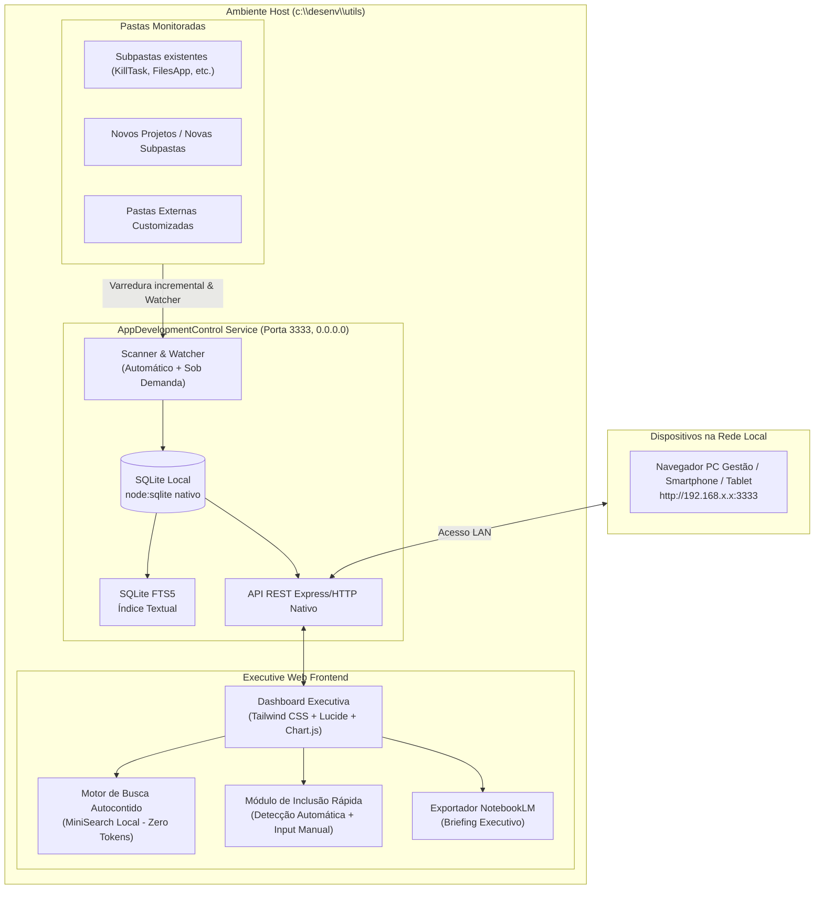

# 001 — AppDevelopmentControl (Local LAN Projects Dashboard) — PLAN

Status: APROVADA (Alexandre / Agente, 2026-10-26).
Fonte da verdade da **arquitetura, tecnologias e componentes técnicos**.

---

## 1. Arquitetura do Sistema

---

## 2. Inclusão Dinâmica de Novos Projetos

Para garantir a máxima facilidade de inclusão de novos projetos:
1. **Detecção Automática de Novas Subpastas**:
   - O scanner re-varre `c:\desenv\utils` a cada intervalo configurável (ex: a cada 10 minutos) e sempre que o usuário clicar em "Sincronizar".
   - Qualquer nova subpasta criada (mesmo sem Git ou em estágio embrionário) é imediatamente catalogada no SQLite.
2. **Cadastro Manual / Apontamento de Novas Pastas**:
   - Endpoint `POST /api/projects/register` e modal visual no frontend.
   - Permite informar o nome do projeto e o caminho absoluto (seja em `c:\desenv\utils` ou em qualquer outro local).
   - O scanner valida o caminho, extrai metadados, cria o registro e já disponibiliza na tela instantaneamente.
3. **Mecanismo de Inicialização Rápida de Specs**:
   - Para projetos novos que ainda não possuem pasta `docs/specs`, a dashboard exibe botão "Criar Estrutura SDD" que inicializa a pasta `docs/specs/001-<nome>/` com templates de `spec.md`, `plan.md` e `tasks.md`.

---

## 3. Componentes Técnicos

1. **Backend**:
   - Node.js v24 (`node:sqlite`, `node:fs`, `node:http`, `node:os`).
   - Escuta em `0.0.0.0:3333` com suporte a CORS local e exibição de todos os IPs da máquina no console e na UI.
2. **Banco de Dados SQLite**:
   - `app_development_control.db`
   - Tabelas: `projects`, `project_activity`, `project_specs`, `alexandre_actions`, `monitored_paths`, `projects_fts` (FTS5).
3. **Frontend**:
   - SPA moderna, design executivo de altíssimo padrão, sem necessidade de build complexo.
   - Paleta: Deep Slate, Navy, Emerald e Amber (**Sem Vermelho**).
   - Busca com MiniSearch local em memória (< 15ms) + SQLite FTS5.
   - Gráficos Chart.js com curvas suaves de commits e status de specs.
   - Exportador estruturado para Google NotebookLM com dossiê executivo.

---

## 4. Adendo de Qualidade e Evolução Técnica (Diretrizes para Agentes Claude e Antigravity)

1. **Auditoria Contínua antes de Alterações**:
   - Qualquer intervenção no sistema deve ser precedida pela execução da suíte de testes (`npm test`) e verificação das tabelas SQLite.
   - Proibido reescrever ou descartar módulos funcionais existentes (`scanner.js`, `db.js`, `server.js`, `lan.js`, `app.js`) sem justificativa técnica explícita documentada.
2. **Precisão e Transparência das Métricas**:
   - Início no computador: primeiro commit local via `git log --reverse --format=%aI -n 1`. Se sem Git, `stat.birthtime` do filesystem.
   - Início no GitHub: primeiro commit remoto `origin/main` ou remote URL identificada. Distinguir visualmente nos cards: "Data Confirmada", "Estimada por Remote" ou "Sem Remote".
   - Commits por período (24h, 7d, 30d): calculados por filtragem de timestamps UNIX exatos do Git.
   - Maior período sem alteração: gap máximo entre commits cronológicos consecutivos (`t[i] - t[i-1]`).
   - Dias sem alteração: tempo decorrido desde `last_commit_date` até o momento presente.
3. **Integridade do Portfólio e Desduplicação de Métricas**:
   - Diferenciar estritamente repositórios principais (`main`), worktrees secundárias (`worktree`) e diretórios sem git (`standalone`).
   - Worktrees derivadas (ex: `FilesApp-*`, `OneToOneSupport-*`) compartilham o mesmo histórico git base; nas métricas consolidadas do portfólio, os commits não devem ser contados em duplicidade.
4. **Rastreabilidade Fina das Pendências do Alexandre**:
   - Cada pendência deve rastrear: projeto, arquivo de origem (`spec.md`, `tasks.md` ou `DECISIONS.md`), linha/contexto, data se presente, e situação (se é um bloqueio ativo ou decisão em aberto).
   - Descartar menções puramente históricas ou resolvidas (ex: `APROVADA (Alexandre)` não é pendência; apenas `PENDING DECISION`, `Aguardando Alexandre` ou checkboxes não marcados `[ ]` dependentes de Alexandre).
5. **Maturidade Documental e Qualidade das Specs**:
   - Distinguir nos dados: (a) Tarefas concluídas em `tasks.md`, (b) Specs integralmente desenvolvidas, (c) Specs aprovadas em `spec.md`, (d) Entregas validadas.
6. **Busca Autocontida e Desconectada**:
   - Manter a busca 100% autocontida (fuzzy matcher em memória no browser + FTS5 no SQLite).
   - Proibida qualquer chamada para APIs externas de LLM na busca.
   - Indexação atualizada automaticamente após cada sincronização (`/api/scan`).
7. **Segurança, Resiliência e Operação Local**:
   - Validação rigorosa dos caminhos recebidos em `/api/projects/register` (impedir traversal fora das unidades autorizadas).
   - Resiliência de persistência do SQLite com fallback transparente entre diretório local e temporário isolado.
   - Disponibilizar arquivos de dependência frontend localmente para garantir funcionamento íntegro mesmo em redes locais sem acesso à internet.
8. **Exportação Opcional para NotebookLM**:
   - A exportação do dossiê Markdown para NotebookLM é uma facilidade auxiliar sob demanda; o sistema jamais deve depender de conexão com internet ou serviços de IA para seu funcionamento operacional normal.
9. **Execução Incremental e Verificabilidade**:
   - Alterações devem ser atômicas, incrementais e reversíveis, com evidências documentadas e verificação de testes em cada passo.

