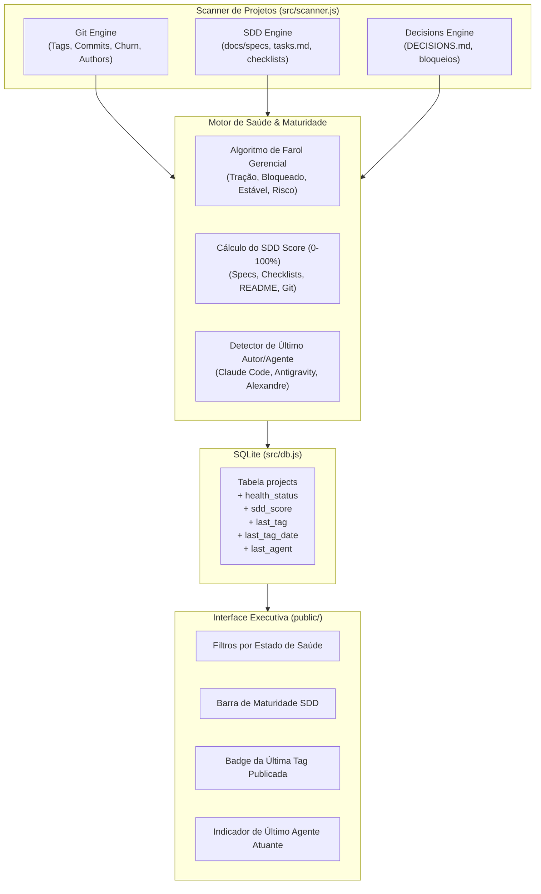

# 002 — Portfolio Health, SDD Maturity & Executive Direction — PLAN

Status: APROVADA (Alexandre / Agente, 2026-10-27).
Fonte da verdade da **arquitetura, algoritmos de cálculo e componentes técnicos**.

---

## 1. Arquitetura dos Novos Indicadores



---

## 2. Algoritmos de Cálculo

### 2.1 Algoritmo de Health Status (Farol de Saúde Gerencial)
A classificação do projeto segue uma árvore de decisão determinística e auditável:

```js
function computeHealthStatus(project) {
  // 1. Bloqueado / Atenção (Prioridade Máxima)
  if (project.alexandre_pending_count > 0) {
    return {
      status: 'blocked',
      label: 'Bloqueado / Atenção',
      tone: 'amber',
      reason: `${project.alexandre_pending_count} decisão/ação do Alexandre pendente`
    };
  }

  // 2. Em Risco / Dormente (Parado sem concluir)
  if (project.days_since_last_change > 45 && project.pending_specs > 0) {
    return {
      status: 'stale',
      label: 'Em Risco / Dormente',
      tone: 'amber',
      reason: `Sem alteração há ${project.days_since_last_change}d com ${project.pending_specs} specs pendentes`
    };
  }

  // 3. Em Tração (Ativo recentemente)
  if (project.changes_7d > 0 || (project.changes_30d > 5 && project.days_since_last_change <= 14)) {
    return {
      status: 'active',
      label: 'Em Tração',
      tone: 'emerald',
      reason: `${project.changes_7d} commits nos últimos 7d (${project.changes_30d} no mês)`
    };
  }

  // 4. Estável / Concluído (Entregue e sem débitos abertos)
  if (project.total_specs > 0 && project.pending_specs === 0 && project.alexandre_pending_count === 0) {
    return {
      status: 'stable',
      label: 'Estável / Concluído',
      tone: 'slate',
      reason: `Todas as ${project.total_specs} specs concluídas e sem bloqueios`
    };
  }

  // 5. Em Incubação / Protótipo
  if (project.total_specs === 0) {
    return {
      status: 'incubating',
      label: 'Em Incubação',
      tone: 'indigo',
      reason: 'Estrutura formal de specs SDD ainda não criada'
    };
  }

  // Fallback padrão: Manutenção / Pausado
  return {
    status: 'paused',
    label: 'Pausado',
    tone: 'slate',
    reason: `Inativo há ${project.days_since_last_change}d`
  };
}
```

### 2.2 Algoritmo do SDD Maturity Score (0 a 100%)
Avalia a disciplina metodológica do repositório conforme o `METODO.md`:
- **Specs SDD estruturadas (+35%)**:
  - Possui pasta `docs/specs` com ao menos uma spec válida: +20%
  - Possui `spec.md`, `plan.md` e `tasks.md` bem estruturados: +15%
- **Taxa de conclusão e checklist de tarefas (+30%)**:
  - Razão entre tarefas concluídas `[x]` e tarefas totais: `Math.round(taxa * 30)`%
- **Documentação de Propósito (+20%)**:
  - `README.md` preenchido e não genérico: +15%
  - Manifestos de pacote presentes (`package.json`, `pubspec.yaml`, `*.csproj`): +5%
- **Higiene e Rastreabilidade Git (+15%)**:
  - Repositório Git ativo com branches e histórico limpo: +10%
  - Existência de tags de versão/segurança (`tag_*` ou `v*`): +5%

### 2.3 Detecção de Tags de Release e Checkpoint
Executa:
```cmd
git describe --tags --abbrev=0
```
e obtém a data da tag via:
```cmd
git log -1 --format=%aI <tag_name>
```
Respeita o padrão de checkpoint do Alexandre: `tag_<versão>_<palavra-chave>` (ex: `tag_2.6.0_seguranca`).

### 2.4 Detecção de Pegada de Agentes (Agent Footprint)
Examina as mensagens e autores dos últimos 10 commits git para identificar:
- **Claude Code**: Presença de termos como `Claude`, `anthropic`, commits assinados pelo Claude ou padrões de co-autoria.
- **Antigravity**: Presença de `Antigravity`, `AGY`, commits gerados pela ferramenta.
- **Alexandre**: Commits diretos do usuário ou de aprovação humana.

---

## 3. Schema SQLite e Migrações (`src/db.js`)

Colunas adicionadas à tabela `projects`:
- `health_status` TEXT DEFAULT 'incubating'
- `health_reason` TEXT
- `sdd_score` INTEGER DEFAULT 0
- `last_tag` TEXT
- `last_tag_date` TEXT
- `last_agent` TEXT

Índice FTS5 atualizado para incluir `health_status`, `last_tag` e `last_agent` na busca inteligente autocontida.

---

## 4. Atualizações na Interface Web (`public/`)

1. **Card de Projeto**:
   - Selo de Saúde no cabeçalho: 🟢 Em Tração, 🟡 Bloqueado, ⚪ Estável, 🟣 Incubação.
   - Micro-barra de score: `SDD: 85%` com cor esmeralda/índigo.
   - Badge da última tag: ex: 🏷️ `tag_2.6.0_seguranca` (com dias decorridos).
2. **Barra de Filtros**:
   - Chips: `Todos`, `Em Tração`, `Bloqueados`, `Estáveis`, `Em Incubação`, `Com Worktrees`.
3. **Modal de Detalhes**:
   - Diagnóstico completo de saúde gerencial com o motivo da classificação.
   - Detalhamento dos fatores do SDD Score (Specs, Checklists, README, Tags).
4. **Briefing NotebookLM**:
   - Nova seção estruturada dedicada à saúde de portfólio para consumo do Gemini e geração de Audio Overviews.

---

## 5. Garantia de Conformidade com as Regras do Usuário
- **Zero Vermelho**: Cores aplicadas exclusivamente em Deep Slate, Emerald Green, Amber Gold, Indigo e Cyan.
- **Zero Tokens**: Cálculos puramente estáticos e locais em JavaScript e SQLite.
- **Conexão Offline**: Nenhum recurso requer chamadas externas para funcionar na rede local.

